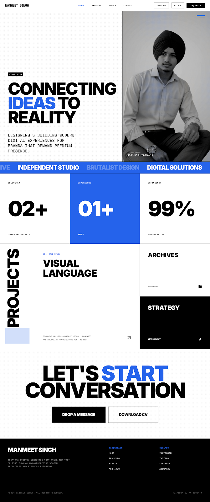
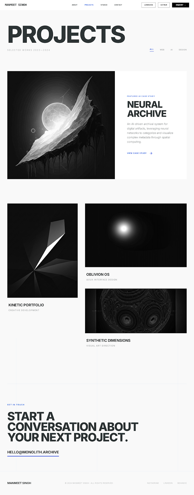
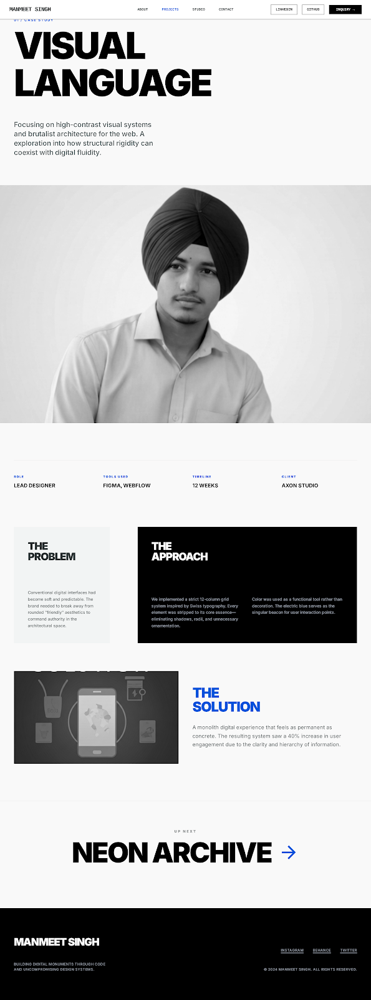
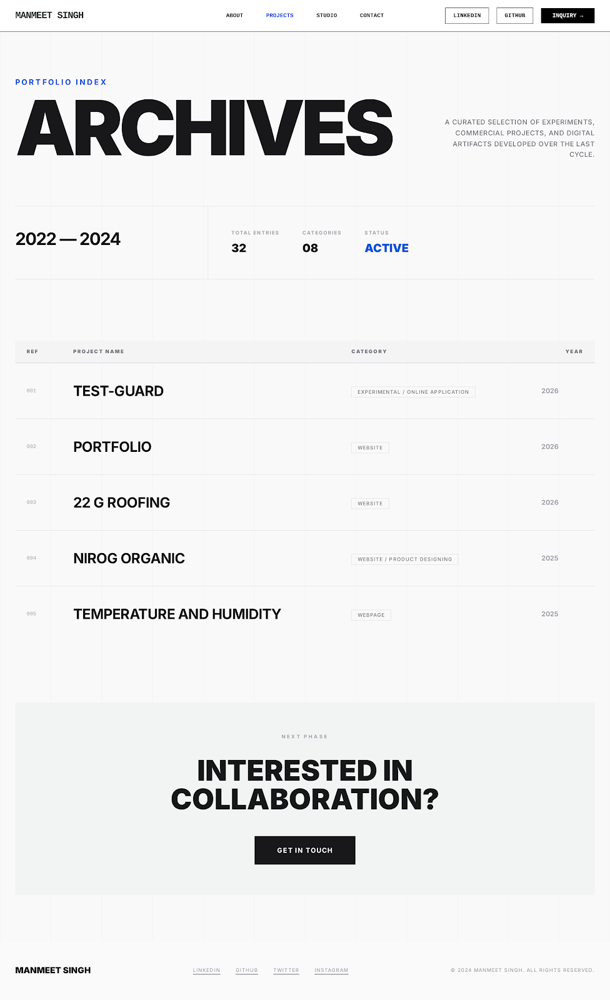
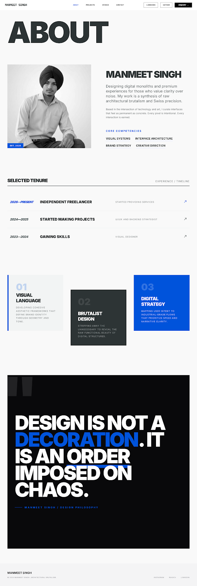
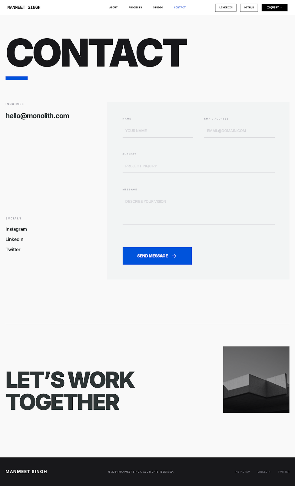

# MANMEET SINGH | Portfolio



## 🏛️ The Digital Monolith

This portfolio is a curated digital gallery designed with a philosophy of **High-End Editorial Brutalism**. Moving away from the soft, rounded aesthetics of modern SaaS, it embraces the raw energy of Swiss Graphic Design and Architectural Brutalism.

### ✨ Design Core
- **Aesthetic**: Intentional asymmetry, sharp 90-degree angles, and a high-contrast typographic scale.
- **Palette**: Sophisticated grayscale tones punctuated by a high-vibrancy kinetic blue (`#0053db`).
- **Typography**: **Inter** variable face for a Swiss-inspired, high-fashion look.
- **Rules**: Strictly **0px border-radius** across all elements to maintain architectural integrity.

---

## 🚀 Experience the Showcase

| Page | Description | Preview |
| :--- | :--- | :--- |
| **Home** | The main entry point featuring "The Digital Monolith" hero. |  |
| **Projects** | An editorial archive of selected works (2022—2024). |  |
| **Case Study** | Deep dives into visual language and brutalist architecture. |  |
| **Archives** | A comprehensive list of independent studio works. |  |
| **About** | The synthesis of raw architectural brutalism and Swiss precision. |  |
| **Contact** | A functional inquiry system powered by Supabase. |  |

---

## 🛠️ Tech Stack & Architecture

*   **Logic**: Vanilla JavaScript
*   **Styling**: [Tailwind CSS](https://tailwindcss.com/) (Customized Configuration)
*   **Database**: [Supabase](https://supabase.com/) (Inquiry System)
*   **Typography**: Google Fonts (Inter, Space Mono)
*   **Icons**: Material Symbols Outlined

### ⚙️ Local Development

Since this project uses a pure HTML/Tailwind CDN approach, no complex installation is required.

1.  **Clone the Repository**:
    ```bash
    git clone https://github.com/manmeet8549/Portfolio-Manmeet.git
    ```
2.  **Open in Browser**:
    Open `portfolio/index.html` directly in any modern browser.
3.  **Supabase Setup**:
    To enable the contact form, ensure your Supabase credentials are configured in `portfolio/js/supabase-config.js`.

---

## 🎨 Creative Methodology

1.  **Clarity over Complexity**: Every pixel is intentional; every interaction is earned.
2.  **Grid Adherence**: A strict 12-column grid system defines the spatial harmony of every page.
3.  **Atmospheric Depth**: Depth is achieved through tonal layering rather than generic shadows.

---

## 📬 Contact

For project inquiries or collaborations, visit the [Contact Page](portfolio/contact.html).

© 2024 Manmeet Singh. Built with uncompromising design principles.
